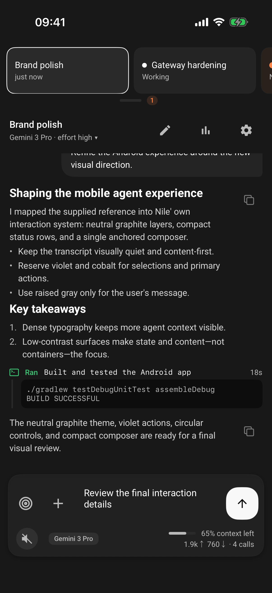
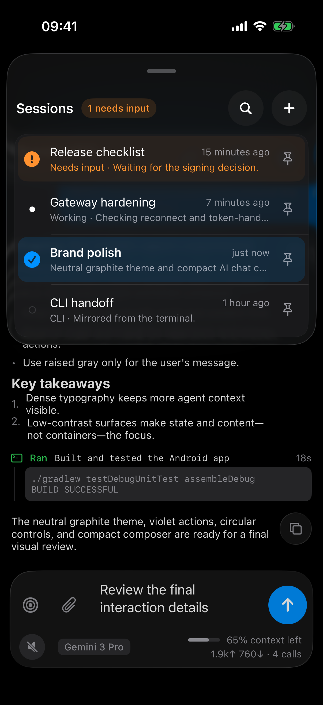
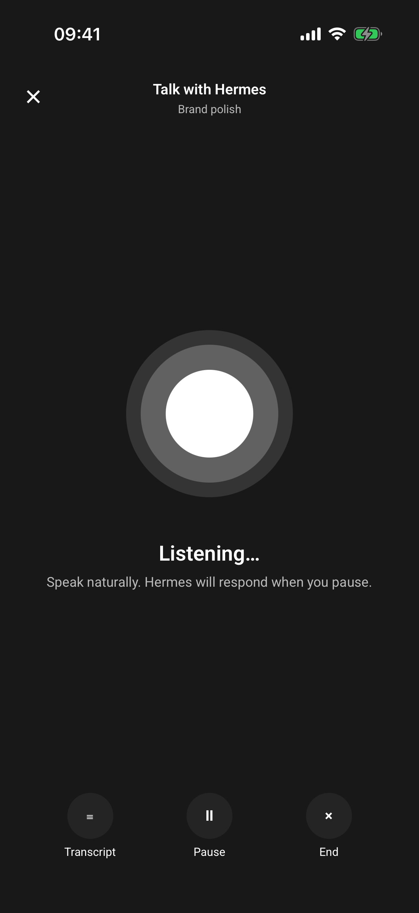

# Nile for iOS

Nile is a native iOS client for Hermes, an agent runtime exposed through the
`tui_gateway` JSON-RPC WebSocket API. It brings session management, live agent
transcripts, approvals, attachments, voice interaction, goals, and delegated
work to iPhone in a SwiftUI/UIKit application.

> [!IMPORTANT]
> Nile is under active development. The native port has substantial tested
> functionality, but final Android parity, strict visual acceptance, and the
> credentialed real-Hermes release gate are not complete. Treat the current
> build as pre-release software.

## App preview

| Agent chat | Session switcher | Talk with Hermes |
| --- | --- | --- |
|  |  |  |

The screenshots use deterministic, secret-free fixtures captured from the iOS
app on an iPhone 17 Pro Simulator.

## What Nile does

- Connects to user-managed Hermes gateways over HTTPS and WebSocket.
- Supports dashboard sign-in and legacy local session-token authentication.
- Browses, searches, opens, pins, renames, and switches Hermes sessions.
- Streams transcripts with Markdown, code, tables, tool activity, plans, todos,
  diffs, media, and delegated-agent state.
- Sends prompts and photo attachments, including camera and photo-library input.
- Handles clarifications, approvals, secrets, and administrator-password prompts
  through fail-closed, one-shot response flows.
- Provides voice dictation, spoken replies, and a hands-free Talk mode.
- Surfaces model, reasoning, context, goal, delegation, and usage controls when
  the connected Hermes gateway supports them.
- Offers optional Face ID or Touch ID app locking.

Hermes itself is not bundled with Nile. You need access to a compatible gateway
before the production app can connect.

## Requirements

- macOS with Xcode and an iOS 17-or-newer SDK
- Swift 6 support
- [XcodeGen](https://github.com/yonaskolb/XcodeGen) 2.46 or newer
- an iPhone or iOS Simulator
- a compatible Hermes `tui_gateway` endpoint

Repository-owned test lanes currently target an iPhone 17 Pro Simulator running
iOS 26.5. Other supported iOS 17+ devices can build and run the app, but they do
not reproduce the pinned visual-test environment.

## Quick start

Generate the Xcode project from `project.yml`:

```bash
xcodegen generate
open Nile.xcodeproj
```

Or build from the command line:

```bash
xcodebuild \
  -project Nile.xcodeproj \
  -scheme Nile \
  -configuration Debug \
  -destination 'platform=iOS Simulator,name=iPhone 17 Pro,OS=26.5' \
  -derivedDataPath build/DerivedData \
  build
```

On first launch:

1. Choose **Add gateway**.
2. Enter the HTTPS URL for your Hermes dashboard or gateway.
3. Sign in through the dashboard, or supply a session token when using a legacy
   local gateway.
4. After the connection succeeds, choose or create a Hermes session.

Debug and LocalRelease builds can connect to explicitly approved HTTP/WS
gateways for local development. Release builds do not include the cleartext
transport exception and require HTTPS/WSS.

## Build configurations

| Configuration | Intended use | Cleartext gateways | Debug fixtures |
| --- | --- | --- | --- |
| `Debug` | Development and deterministic UI tests | Explicitly approved per profile | Included |
| `LocalRelease` | Optimized local and test-lab validation | Explicitly approved per profile | Included |
| `Release` | Production and App Store builds | Disabled | Excluded |

Do not add a personal development team, provisioning profile, signing identity,
or credential file to the repository.

## Privacy and security

Nile has no developer-operated cloud service. The app communicates with the
Hermes gateway you configure and with sign-in origins you explicitly approve.
The source does not include a third-party analytics or advertising SDK.

Current data-handling boundaries include:

- reusable gateway tokens are stored in non-synchronizing, this-device-only
  Keychain items;
- gateway metadata, text drafts, photo drafts, and pin state use protected local
  files that are excluded from backup;
- dashboard authentication uses a persistent WebKit cookie store;
- microphone audio is captured only during voice input or Talk mode and is sent
  to the configured gateway for transcription;
- photos are read only after a camera or photo-library action;
- local notifications use generic text rather than transcript content;
- downloaded attachments use a protected, backup-excluded cache bounded to 12
  entries and 96 MiB.

Before App Store distribution, the project still needs a bundled
`PrivacyInfo.xcprivacy`, a public privacy policy, and completion of the remaining
cache and website-data cleanup work. See
[`docs/ARCHITECTURE.md`](docs/ARCHITECTURE.md) for the implemented security
boundaries and [`docs/IOS_PORT_PROGRESS.md`](docs/IOS_PORT_PROGRESS.md) for open
work.

## Testing

Run the unit and protocol contracts:

```bash
xcodebuild \
  -project Nile.xcodeproj \
  -scheme Nile \
  -configuration Debug \
  -destination 'platform=iOS Simulator,name=iPhone 17 Pro,OS=26.5' \
  -derivedDataPath build/DerivedData \
  test -only-testing:NileTests
```

Run UI contracts by replacing the final argument with
`test -only-testing:NileUITests`.

The disposable test lab provides the repository's broader verification lanes:

```bash
./scripts/test-lab/doctor.sh full
./scripts/test-lab/run.sh unit
./scripts/test-lab/run.sh ui
./scripts/test-lab/run.sh accessibility
./scripts/test-lab/run.sh visual
./scripts/test-lab/run.sh smoke
./scripts/test-lab/run.sh full
```

Each runner creates and deletes a fresh Simulator and retains sanitized evidence
under `build/test-lab-results/`. The `full` lane is the final acceptance gate and
is not yet green on the current port. Some real-Hermes phases require a provider
credential through the test lab's secure, one-use handoff; never export or commit
that credential.

## Project layout

```text
Sources/Nile/App          App entry point, application state, fixtures, and IDs
Sources/Nile/Core         Design, persistence, media, speech, and platform code
Sources/Nile/Domain       Models and narrow repository capability contracts
Sources/Nile/Data/Gateway Hermes REST/WebSocket transport and wire codecs
Sources/Nile/Features     SwiftUI and UIKit feature surfaces
Tests/NileTests           Unit, architecture, and protocol-contract tests
Tests/NileUITests         Accessibility-ID-driven UI contracts
Config                    Build configurations and transport policy
docs                      Architecture, parity, evidence, and progress records
scripts                   Project generation, visual, reference, and test tools
```

## Android parity

The iOS port targets functional, security, and app-owned visual parity with a
pinned Android revision. The reference checkout is not included in this
repository and is always treated as read-only. A successful compile or fixture
test alone is not evidence of parity.

The detailed acceptance contract lives in
[`IOS_PORT_GOAL.md`](IOS_PORT_GOAL.md), with row-by-row status in
[`docs/PARITY_MATRIX.md`](docs/PARITY_MATRIX.md).

## Documentation

- [`IOS_PORT_GOAL.md`](IOS_PORT_GOAL.md): completion and acceptance contract
- [`docs/IOS_PORT_PROGRESS.md`](docs/IOS_PORT_PROGRESS.md): current implementation
  and verification record
- [`docs/PARITY_MATRIX.md`](docs/PARITY_MATRIX.md): Android-to-iOS parity status
- [`docs/ARCHITECTURE.md`](docs/ARCHITECTURE.md): architecture and security model
- [`docs/TEST_LAB.md`](docs/TEST_LAB.md): disposable test-lab contract
- [`docs/VISUAL_PARITY.md`](docs/VISUAL_PARITY.md): visual comparison workflow
- [`docs/USER_EDGE_CASE_AUDIT.md`](docs/USER_EDGE_CASE_AUDIT.md): user-facing edge
  cases and hardening evidence

## Contributing

Read [`AGENTS.md`](AGENTS.md) before changing the project. It contains the
repository's engineering, testing, security, and completion rules.

In particular:

- edit `project.yml`, then regenerate the checked-in Xcode project;
- keep Hermes wire formats inside `Sources/Nile/Data/Gateway`;
- use strict Swift concurrency and keep UI state on `@MainActor`;
- write focused tests for behavior changes and use accessibility identifiers in
  UI tests;
- never commit credentials, cookies, real speech, personal screenshots, signing
  configuration, or generated test artifacts;
- do not claim parity from compile-only or mock-only evidence.

## Third-party software

Bundled fonts and the Android text renderer include their applicable licenses
and notices. See [`THIRD_PARTY_NOTICES.md`](THIRD_PARTY_NOTICES.md).

## License

A project-wide open-source license has not been selected yet. Until one is
added, the source is available for inspection but is not licensed for reuse or
redistribution.
